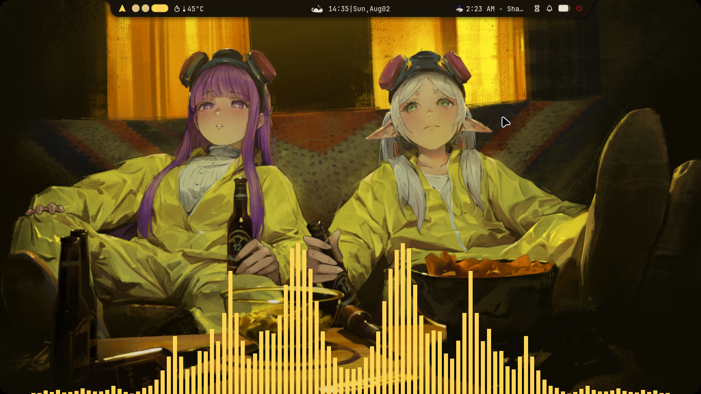
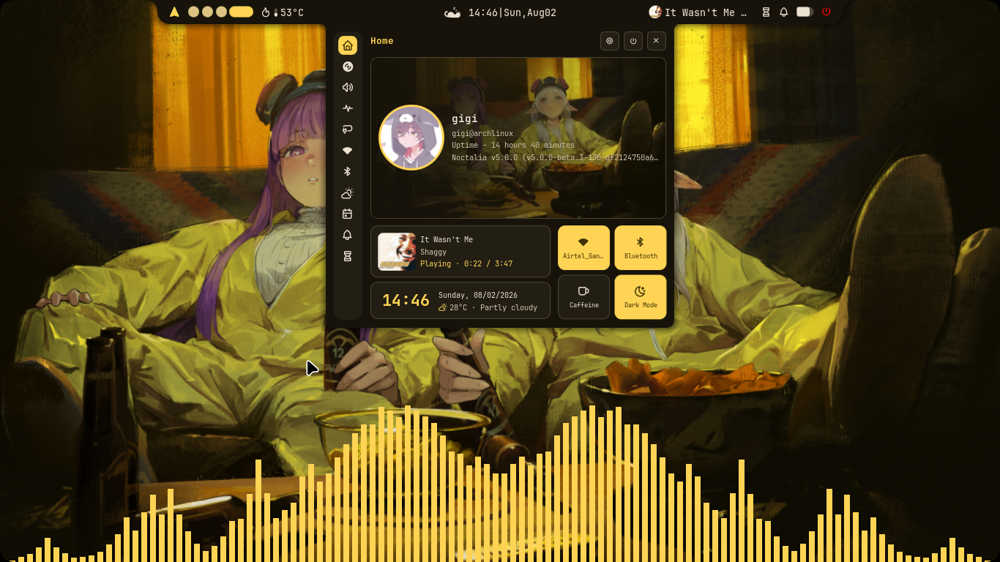
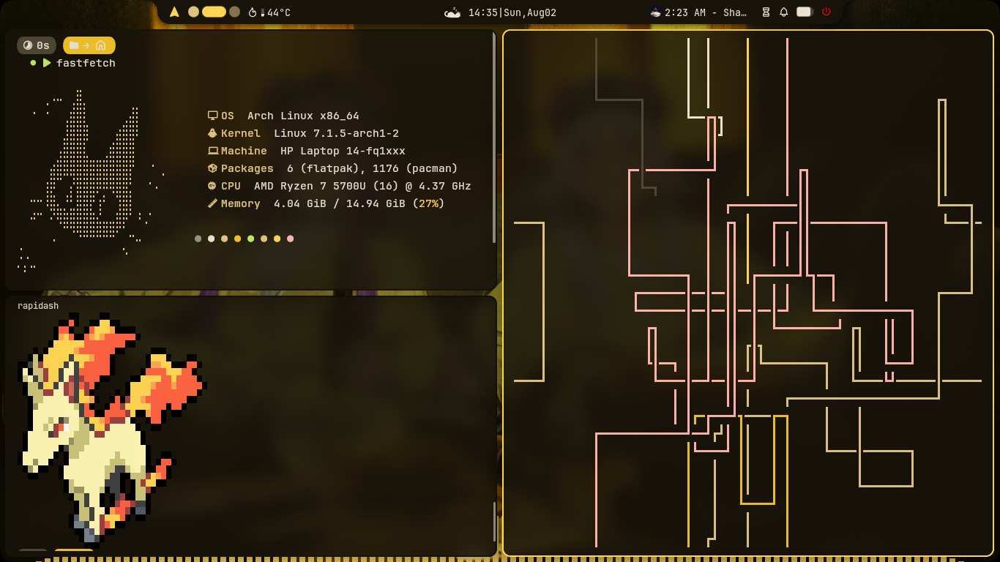
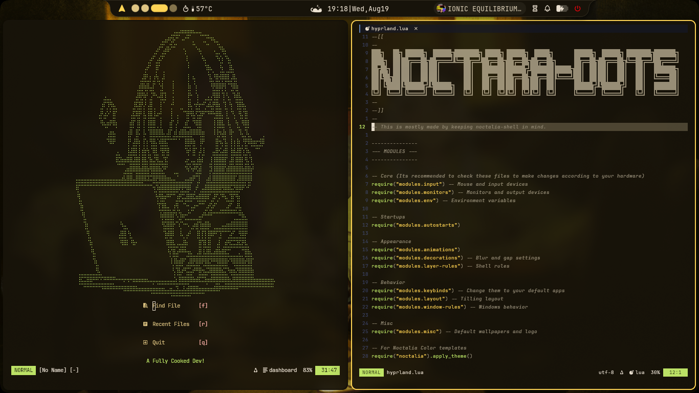
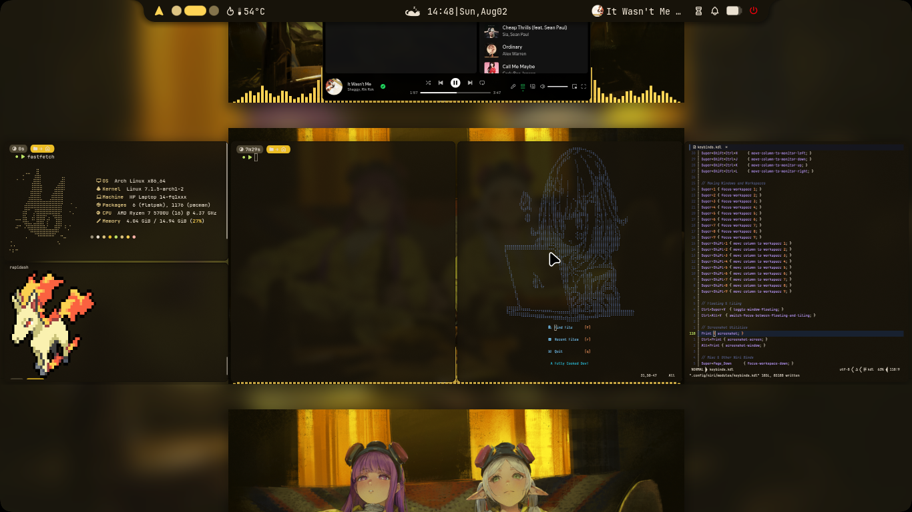
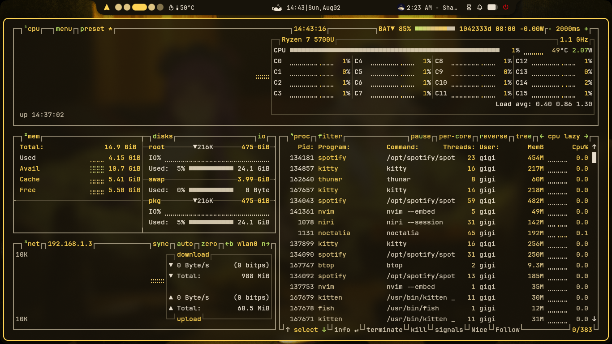

<div align="center">

# 🌙 Noctara-dots

<sub><i>Because your desktop deserves better life choices.</i></sub>




</div>

---

# ✨ Overview

**Noctara-dots** is my personal desktop rice for **Arch Linux**, built around **Noctalia v5**.

The idea is simple. Install it, log back in, and have a clean desktop that's already configured and ready to use instead of spending hours tweaking everything yourself.

Everything is modular, so if you don't like something, changing it is easy.

---

# ❓ Why Noctara-dots?

**Noctalia v5** already provides an incredible desktop shell with plenty of customization.

However, Noctalia focuses on being a shell, not a complete desktop environment.

You're still responsible for configuring your compositor, managing keybindings, setting up animations, choosing applications, matching themes across your terminal and editor, configuring media players, file managers, shell prompts, wallpapers, and dozens of little details that eventually turn into hours of configuration.

Noctara-dots solves that problem.

It extends Noctalia into a complete desktop experience by bringing everything together with a consistent design and workflow.

Once installed, simply log out, log back in, and start using your desktop.

If something isn't exactly how you like it, changing it is easy. The configurations are modular, making it simple to swap applications, edit keybindings, or customize individual components without digging through one massive configuration file.

---

# 🖼 Showcase

<details>
<summary>🌙 Desktop</summary>



</details>

<details>
<summary>💻 Terminal Setup</summary>



</details>

<details>
<summary>📝 Neovim Setup</summary>



</details>

<details>
<summary>🪟 Niri Overview</summary>



</details>

<details>
<summary>📊 Resources Monitor</summary>



</details>

---

# ✨ Features

- 🚀 One-command installation
- 📦 Automatic package installation
- 🔄 Backup and restore support
- 🧩 Modular configuration files
- 🪟 Niri & Hyprland support
- 🎨 Consistent theming across applications
- 💻 Ready-to-use development environment

---

# 🛠 Software Used

| Component          | Software        |
| ------------------ | --------------- |
| Desktop Shell      | Noctalia v5     |
| Window Manager     | Niri / Hyprland |
| Terminal           | Kitty           |
| Shell              | Fish            |
| Prompt             | Starship        |
| Editor             | Neovim          |
| File Manager       | Yazi            |
| Music              | MPD + rmpc      |
| Media Player       | MPV             |
| System Information | Fastfetch       |

---

# 📦 Installation

## Requirements

Before installing Noctara-dots, make sure you have:

- An Arch Linux based distribution
- Niri or Hyprland installed
- Internet connection

Don't worry if you don't have an AUR helper installed.

---

## Automatic Installation (Recommended)

Clone the repository:

```bash
git clone https://github.com/deadduck-09/noctara-dots.git
cd noctara-dots
```

Make the installer executable:

```bash
chmod +x install.sh
```

Run the installer:

```bash
./install.sh
```

When the installation is complete:

1. Log out:

```text
Ctrl+Alt+Del
```

2. Log back in.
3. Enjoy your new desktop.
4. Take a look through the configs and make it yours.

---

### Installer Features

The installer automatically:

- Installs required packages
- Detects whether you're using Niri or Hyprland
- Installs matching configurations
- Creates backups of existing configurations
- Restores previous backups when requested
- Handles official repositories and AUR packages
- Installs missing dependencies

---

## Manual Installation

Prefer doing everything yourself?

Simply copy whichever configuration folders you want into your `~/.config` directory.

Example:

```bash
cp -r configs/niri ~/.config/
cp -r configs/noctalia ~/.config/
cp -r configs/kitty ~/.config/
```

Copy the wallpapers:

```bash
mkdir -p ~/Pictures/Wallpapers
cp wallpapers/* ~/Pictures/Wallpapers/
```

You can mix and match components however you'd like.

---

# ⌨️ Keybindings

<details>

<summary><strong>View Default Keybindings</strong></summary>

### 🌙 Noctalia

| Shortcut    | Action               |
| ----------- | -------------------- |
| Super + L   | Lock Screen          |
| Super + ,   | Wallpaper Picker     |
| Super + .   | Emoji Picker         |
| Super + V   | Clipboard History    |
| Super + D   | Control Center       |
| Alt + Space | Application Launcher |

---

### 🚀 Applications

| Shortcut  | Action       |
| --------- | ------------ |
| Super + T | Kitty        |
| Super + B | Browser      |
| Super + E | File Manager |
| Super + M | Music        |
| Super + O | Notes        |
| Super + C | Code Editor  |

</details>

---

# 📌 Default Applications

<details>

<summary><strong>View Default Applications</strong></summary>

| Category        | Application |
| --------------- | ----------- |
| 🌐 Browser      | Helium      |
| 💻 Terminal     | Kitty       |
| 📝 Code Editor  | VSCodium    |
| 📖 Notes        | Obsidian    |
| 📂 File Manager | Thunar      |
| 🎵 Music        | Spotify     |

All shortcuts are configured around these applications by default, but changing them only requires editing a few lines thanks to the modular configuration.

</details>

---

# 🌄 Wallpapers

For my complete wallpaper collection, visit:

➡️ **[FireWalls](https://github.com/deadduck-09/FireWalls)**

---

# 📂 Repository Structure

```text
.
├── assets
├── configs
│   ├── btop
│   ├── cava
│   ├── fastfetch
│   ├── fish
│   ├── hypr
│   ├── kitty
│   ├── mpd
│   ├── mpv
│   ├── niri
│   ├── noctalia
│   ├── nvim
│   ├── rmpc
│   ├── starship.toml
│   └── yazi
├── home
├── install.sh
├── LICENSE
├── local
│   ├── share
│   └── state
├── Pictures
│   ├── Pfps-and-logos
│   └── Wallpapers
└── README.md
```

---

# ❤️ Credits

A huge thank you to the developers behind these amazing open-source projects.

- **[Niri](https://github.com/YaLTeR/niri)**
- **[Noctalia](https://github.com/NoctaliaDev/noctalia-shell)**
- **[Kitty](https://sw.kovidgoyal.net/kitty/)**
- **[Neovim](https://github.com/neovim/neovim)**
- **[MPD](https://github.com/MusicPlayerDaemon/MPD)**
- **[rmpc](https://github.com/mierak/rmpc)**
- **[Fastfetch](https://github.com/fastfetch-cli/fastfetch)**
- **[Yazi](https://github.com/sxyazi/yazi)**
- **[MPV](https://github.com/mpv-player/mpv)**

Noctara-dots wouldn't exist without these amazing projects

---

# ⭐ Support

If you enjoy Noctara-dots:

- ⭐ Star the repository
- 🍴 Fork it
- 🛠 Customize it
- 💜 Share it with others

Every contribution, issue report, suggestion, or star helps make the project even better.

---

> _"My desktop may look minimal, but the hours spent configuring it definitely weren't."_ 🌙
